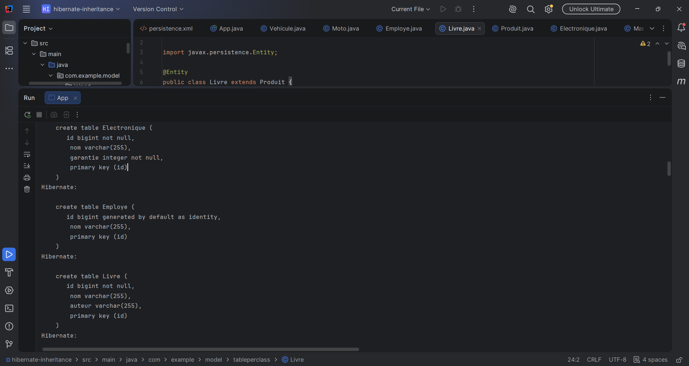
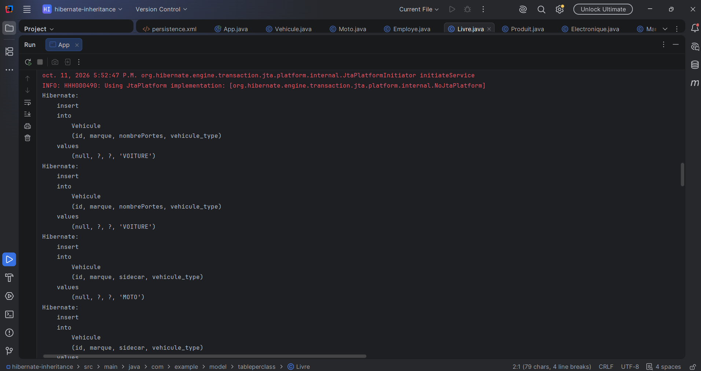
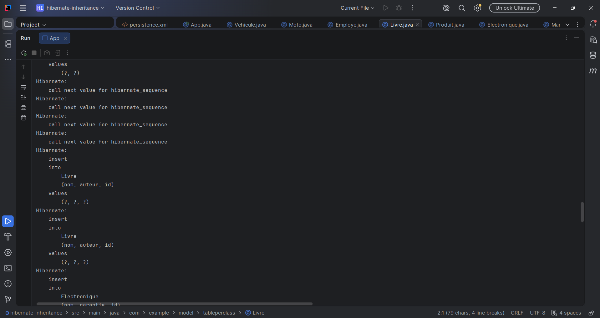
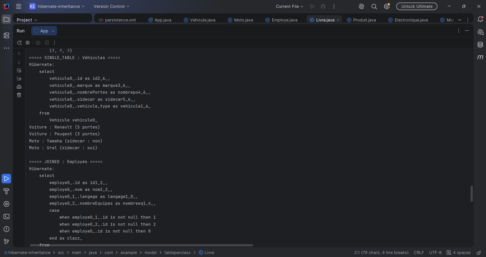
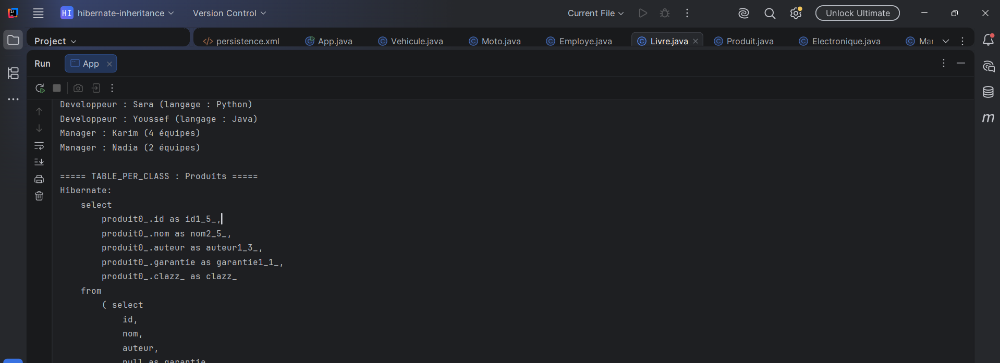
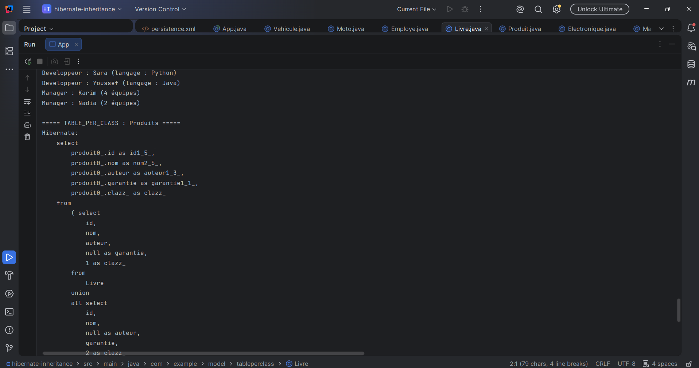
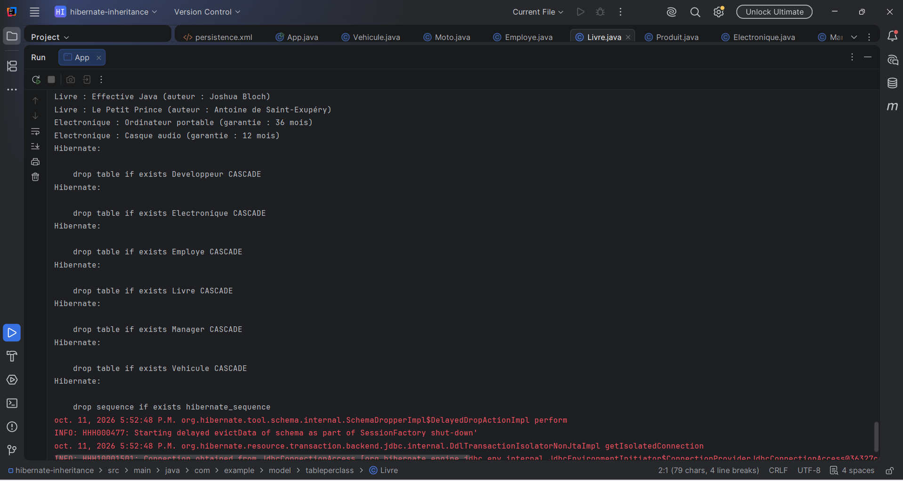

# TP4 : Stratégies d'héritage avec JPA / Hibernate

## Description
Projet Maven (JPA, Hibernate 5.4, base H2 en mémoire) qui compare les trois stratégies d'héritage.

| Stratégie | Entités | Tables créées |
|---|---|---|
| SINGLE_TABLE | Vehicule, Voiture, Moto | 1 table `Vehicule` (colonne `vehicule_type`) |
| JOINED | Employe, Developpeur, Manager | `Employe` + 1 table par sous-classe |
| TABLE_PER_CLASS | Produit, Livre, Electronique | 1 table par classe concrète, requête `union all` |

## Structure du dépôt
- [hibernate-inheritance](./hibernate-inheritance) : code source du projet Maven
- [lab4](./lab4) : captures d'écran de l'exécution

## Exécution
Lancer la classe `com.example.App`.

## Preuves d'exécution

### 1. Capture 1

### 2. Capture 2

### 3. Capture 3

### 4. Capture 4

### 5. Capture 5

### 6. Capture 6

### 7. Capture 7

